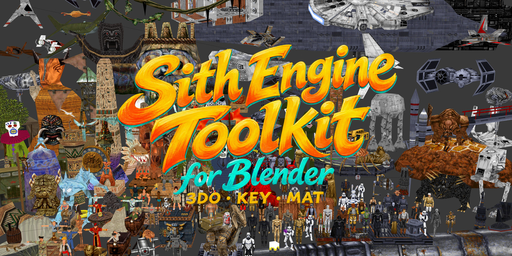

> **Community fork: Blender-Sith Agentic — 1.1.0 release.** This source integrates upstream **01ff4bd** with Coda's reviewed hexadecimal-property and native-pivot changes (PR16/PR23) and retained automation. The release is **v1.1.0-coda.1**; exact-package validation passed on Windows Python/bpy, native Linux and native Apple Silicon macOS; see [release evidence](docs/release-1.1.0-coda.1.md). The [published 1.0.4 record](docs/release-1.0.4-coda.1.md) remains historical evidence for its own bytes. See [provenance and migration](FORK.md), [package status](docs/platform-builds.md#latest-install-route) and [explicit API/target usage](docs/agent-use.md). Original Blender-Sith authorship and GPL history are retained. The optional [MCP companion](docs/MCP.md) is separate.

<div align="center">

# 🎮 Sith Engine Toolkit for Blender

[](https://www.blender.org/)
[](https://github.com/smlu/blender-sith/actions/workflows/tests.yml)
[](LICENSE)


**Import/Export assets for classic LucasArts games**

[](demo/blsthbn.png)

[🚀 Installation](#-installation) • [📖 Usage Guide](USAGE.md) • [🔧 Troubleshooting](USAGE.md#-troubleshooting)

</div>

---

## 📑 Table of Contents

- [Supported Games](#️-supported-games)
- [Features](#-features)
- [Quick Start](#-quick-start)
- [Requirements](#-requirements)
- [Installation](#-installation)
- [Usage](USAGE.md)
- [Technical Documentation](docs/README.md)
- [Contributing](#-contributing)
- [Tests](#tests)
- [Links](#links)

---

## 🕹️ Supported Games

- Star Wars Jedi Knight: Dark Forces II
- Star Wars Jedi Knight: Mysteries of the Sith
- Star Wars: DroidWorks
- Indiana Jones and the Infernal Machine
- Grim Fandango

---

## ✨ Features

These features describe the integrated 1.1.0 source. Published 1.0.4
packages do not acquire them from this README; choose the exact version and
validation record deliberately.
<div align="center">

</div>
<div align="center">
</div>

---

<table>
<tr>
<td width="50%">

### 📦  3DO Models
- ✅ Import/Export 3DO 2.1, 2.2 and 2.3
- ✅ Grim Fandango MODL binary import/export
- 🎨 Mesh hierarchy editing
- 🔧 Edit properties in Blender UI
- 🎯 Vertex colors & UV mapping

### 🎬 KEY Animations
- ✅ Import/Export mesh animations
- ✅ Grim Fandango FYEK binary import/export
- 🛟 KEY recovery & flexible frame starts
- 🎞️  Keyframe markers support
- ⚙️ Node-type priority masks
- 📊 Fractional playback rates

</td>
<td width="50%">

### 🖼️ MAT Textures
- ✅ Import as Blender materials
- 📤 Export materials/textures to MAT
- 🎞️ Animated texture cels
- 🎨 8-bit, 16-bit, 24-bit & 32-bit formats
- 🔧 ColorMap (.cmp) support
- ✅ Grim Fandango indexed MAT variants

### 🛠️ Advanced Editing
- 🎛️ Per-face properties & flags
- 🔦 Lighting & texture modes
- 🎨 Extra light color support
- 💡 Live Extra Light preview
- ⚡ Multi-face batch editing

</td>
</tr>
</table>


## ⚡ Quick Start

1. **Select version**: Follow [platform builds](docs/platform-builds.md#latest-install-route) for the 1.1.0 release and its exact validation scope. Use Blender 5.0+ Preferences > Add-ons > Install from Disk for an extension ZIP; source loading is a separate route.
2. **Import Model**: `File > Import > Sith Game Engine 3D Model (.3do)`
3. **Import Textures**: Use MAT Directory option or let auto-search find them
4. **Import Animation**: `File > Import > Sith Game Engine Animation (.key)`
5. **Edit Properties**: Use the 3DO Properties panels (see [Usage Guide](USAGE.md))
6. **Export**: `File > Export` with the intended format/target. For JK/MotS, retain 3DO 2.1, select the JKDF2/MOTS KEY target and choose indexed MAT plus real CMP or a separately tested encoding. Bake procedural shaders to images before MAT export.

> 📖 **Detailed instructions**: See the [Usage Guide](USAGE.md) for complete documentation.

---

## 📋 Requirements

> **Blender 5.0+** is required for this version of the add-on.

🔗 [Download Blender](https://www.blender.org/download/)

---

## 🚀 Installation

### Method 1: From Release (Recommended)

1. 📥 **Download** the chosen named extension ZIP from the [1.1.0 release](https://github.com/CodaLilitari/blender-sith/releases/tag/v1.1.0-coda.1), checking its hash. See the completed [release evidence](docs/release-1.1.0-coda.1.md) and [package status](docs/platform-builds.md).
2. 🔧 **Open Blender** and go to `Edit > Preferences > Add-ons`
3. 📂 **Install**: Click the dropdown menu (▼) at the top-right and select `Install from Disk...`
4. 📁 **Select** the downloaded ZIP file
5. ✅ **Enable** the add-on: Check the box next to **Blender Sith (Coda)**
6. 🎉 **Done!** Import/export options appear in `File > Import` and `File > Export` menus

### Method 2: From Source

```bash
# From an explicitly selected fork source (Python 3.11+, standard library only)
python /path/to/source/scripts/build_extension.py --source-dir /path/to/source --output-dir /external/new-package-directory
```

Install the named ZIP and retain its `.receipt.json`. The fork builder derives
version/platform from the selected manifest, refuses existing output archives,
and keeps output physically outside source and every Git checkout. It records
raw/packaged hashes and normalizes reproducible bytes; see [build details](docs/platform-builds.md).
The shell wrapper `scripts/make_addon.sh` retains the fork's explicit
`--output-dir`/`--source-dir` route to **`build_extension.py`**. Other arguments,
including upstream's `--output ZIP`, go to **`make_addon.py`**. Both Python
builders remain directly callable. A local candidate build is not an already
validated release package.

Blender's 3DO workflow imports/exports **LOD 0 only**. Extra geosets in a source
model are not retained by the Blender round trip; see the [Usage Guide](USAGE.md).

> 💡 **Note**: In Blender 5.0, add-ons are managed through the Extensions system.

---

## 📖 Usage

For complete documentation on importing, exporting, and editing, see the **[Usage Guide](USAGE.md)**.
For byte layouts, field tables and ASCII structure diagrams, see the
[technical documentation](docs/README.md) and [format reference](docs/formats/README.md).
The [Blender pipeline guide](docs/blender-pipeline.md) explains model/animation
conversion, baked pivots, UV units, hierarchy ordering and mesh-list sync.

### Quick Reference

- **Import 3DO**: `File > Import > Sith Game Engine 3D Model (.3do)`
- **Export 3DO**: `File > Export > Sith Game Engine 3D Model (.3do)`
- **Import KEY**: `File > Import > Sith Game Engine Animation (.key)`
- **Export KEY**: `File > Export > Sith Game Engine Animation (.key)`
- **Import MAT**: `File > Import > Sith Game Engine Texture (.mat)`
- **Export MAT**: `Image Editor > Image > Export to MAT...`, or right-click an image/material in the Outliner or a material row in Material Properties
- **Edit Properties**: `Properties Panel > Object Properties > 3DO Properties`
- **Edit Faces**: `Properties Panel > Data Properties > 3DO Mesh Face Properties` (Edit Mode)

> 📖 See [USAGE.md](USAGE.md) for detailed options, screenshots, and troubleshooting.

---

## 🤝 Contributing

Contributions are welcome! Feel free to:
- 🐛 Report bugs via [Issues](https://github.com/smlu/blender-sith/issues)
- 💡 Suggest features or improvements
- 🔧 Submit pull requests

---

## Tests

Resource codecs run in ordinary Python 3.11+ without Blender:

```sh
python -m pip install -r tests/requirements.txt
python tests/run.py --suite core
```

Blender import/export tests run in a separate Blender 5.0+ process:

```sh
blender --background --factory-startup --python-exit-code 1 --python tests/run.py -- --suite app
```

Both suites use standard-library `unittest` and synthetic fixtures. GitHub Actions
configuration includes core jobs on Windows, macOS and Linux, and application
tests in headless Blender on Linux. Completed runs are linked from the [release record](docs/release-1.1.0-coda.1.md). Also run the retained [bounded fork/package checks](docs/agent-use.md),
binding exact source/ZIP hashes and measured runtimes. Use explicit runtime paths,
isolated preferences and deadlines; keep environments/results outside Git trees.
See [tests/README.md](tests/README.md) for coverage, commands and interpolation limits.

## Links

- 📦 [1.1.0 release](https://github.com/CodaLilitari/blender-sith/releases/tag/v1.1.0-coda.1) - Validation scope is recorded in the platform guide
- 🐛 [Issue Tracker](https://github.com/smlu/blender-sith/issues) - Report bugs or request features
- 🌐 [Blender.org](https://www.blender.org/) - Get Blender

---

<div align="center">

**⭐ If you find this project useful, consider giving it a star!**

</div>
