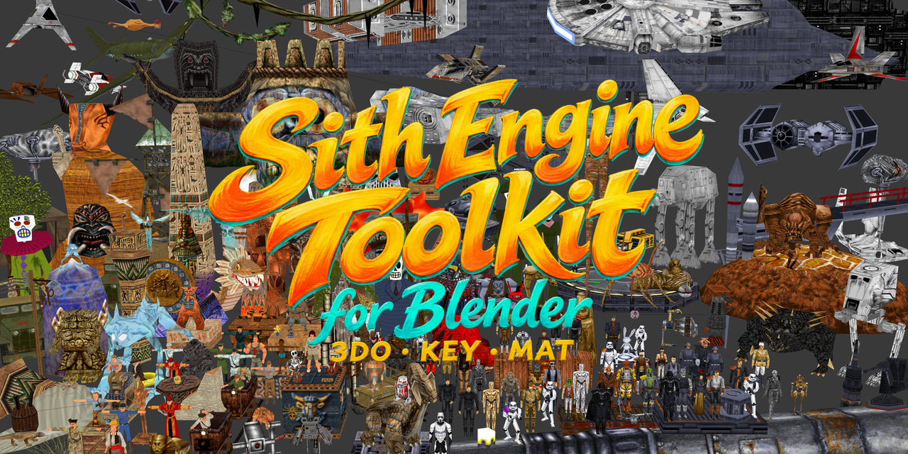

<div align="center">

# 🎮 Blender-Sith Agentic

[](https://www.blender.org/)
[](https://github.com/CodaLilitari/blender-sith/actions/workflows/tests.yml?query=branch%3Amaster)
[](LICENSE)


**smlu's Blender-Sith, plus tools for JK and MotS characters that hold up in the game**

[🚀 Installation](#-installation) • [📖 Usage Guide](USAGE.md) • [🔧 Troubleshooting](USAGE.md#-troubleshooting)

</div>

Blender-Sith Agentic is a community fork of [Blender-Sith](https://github.com/smlu/blender-sith),
the Sith Engine Toolkit for Blender by Crt Vavros (smlu). Coda maintains it with Andrei, under
upstream's GPL-3.0-or-later. It keeps upstream's import, export and editing of 3DO models, KEY
animations and MAT textures, and adds checks and tools for Jedi Knight: Dark Forces II (JKDF2) and
Mysteries of the Sith (MotS) player characters. Blender shows the extension as
**Blender Sith (Coda)**. It has upstream's id, `sith`: install one or the other, not both.

The latest release, [v1.2.0-coda.1](docs/platform-builds.md#latest-install-route), has upstream's
features, native pivots, the binding audit and six of the MCP tools. The rest of the table below,
export options included, is only in this source tree, which is not a release; its manifest still
reads 1.2.0.

## Why this fork exists

Rigid-piece characters on Kyle's skeleton met problems in retail JK.EXE that a still model hides:

- **Joints open.** Some stock KEYs move a joint a few thousandths of a JK unit off its seat.
- **Surface stays behind.** A cut leaves arm surface in the torso piece, in the air when the arm moves.
- **Retail limits.** Vertex splits at sharp edges and UV seams can push a mesh over; the model fails to load.
- **Distance and colour.** Blender wrote one geoset, and 8-bit MATs turned skin into bands.
- **KEYs.** Euler-form switches swing joints; one character's tracks move another's pieces in a pack.
- **Feet and weapons.** Feet sink or float, and a weapon along the camera's view reads as a stub.

## How it differs from upstream

The upstream column is Blender-Sith at
[`168dadc`](https://github.com/smlu/blender-sith/commit/168dadcb1f744da833ec13f0c115fc08652b05f6),
which this fork integrates; the formats, importers, exporters and editing tools are its work.
[FORK.md](FORK.md) records what came from where.

| Area | Upstream Blender-Sith | Blender-Sith Agentic (this source tree) |
| --- | --- | --- |
| Normals at hard edges | Merges corners by position, colour and normal. Custom normals and edges marked sharp keep their own corner normals; ordinary flat shading writes face normals. | The same upstream rule. The export budget counts the vertices these splits add. |
| Model radius | Computes the model radius from the exported vertices through the pivot chain, keeps an authored `RADIUS`, and enlarges mesh radii to enclose their vertices. | The same rules. With native pivots kept or baked, each mesh radius bounds the coordinates actually written. |
| Native pivots and attachments | Import bakes each native pivot into its mesh. Export writes zero pivots, or the offset of a Blender Pivot constraint. | Import keeps each pivot as an editable **Native Pivot**, and export writes it back, so meshes and the frames weapons attach to stay where the original put them. **Bake Pivots** writes zero pivots on request. Proposed upstream as [PR #23](https://github.com/smlu/blender-sith/pull/23). |
| KEY-to-model binding audit | KEY import's **Validate** option checks, in Blender, that the selected model has every node the KEY animates. KEY export checks the target's joint, marker and name limits. | `auditModelKey` compares a 3DO and a KEY without Blender: the node each track addresses, names that differ, JOINTS against the node count, and the JKDF2/MOTS limits. MCP tool `audit_model_key`. |
| Engine-equivalent posing | Not included. A KEY imports into Blender as animation. | `sith.audit.pose` poses a 3DO with KEYs the way the engine's `rdPuppet_BuildJointMatrices` does, without Blender: layers, priorities, joint frames and world vertices. |
| Joint-gap audit and seat offsets | Not included. | `auditArticulation` counts the lines of sight through each joint that meet no polygon (daylight), in every sampled pose of every KEY. `seatOffsets` gives how far each KEY moves each node off its seat. |
| Rigid-piece cut lint | Not included. | `auditSegmentation` finds surface a cut left in the wrong piece. `removeFaces` takes it out and caps the opening. **Colour Pieces** paints each piece in Blender. |
| Retail budget at export, and detail levels | Imports and exports geoset 0 only. `save3do` warns about long names; vertex and face counts are not checked. | Every 2.1 export counts the model it writes against the retail limits (512 vertices, 768 texture vertices and 512 faces per mesh, 64 nodes) and warns, or stops with **Fail Over Retail Limits**. **Detail Levels** writes up to four identical geosets. **Check Retail Limits** counts before you export. |
| MAT dithering and both editions | Writes MATs in six encodings; Indexed takes the nearest palette colour. One encoding per export. | Optional ordered 4x4 dithering for Indexed MATs, limited by a mask such as the skin. A pattern never adds a fullbright palette entry, one the CMP's light table never darkens. **Avoid Fullbright Colours** keeps those entries out altogether; it needs a JKDF2/MOTS CMP with its light table. One 3DO export can write an 8-bit Indexed and a 16-bit RGB565 edition with the same file names, in two folders; RGB565 has no transparency, so cut-outs are opaque in the 16-bit edition. |
| KEY lint | Not included. KEY export checks the target's limits: for JKDF2 and MOTS, 64 joints, 8 markers and 31-character names. | `lintKeyHeader` (tracks past JOINTS, tracks numbered 64 and above, entry order, JOINTS below the model's node count, and the target's header limits with or without a model), `scanKeyPops` (pops at and between entries, such as Euler flips and jumps at an entry), `keyPriorityReport`, and `trackRegistry` (track slots that clash between characters in one pack). KEY export writes each converted rotation as the Euler triple nearest the previous one. |
| Floor, slip and camera checks | Not included. | `auditFloorContact` against a floor you give it, such as the engine floor from `thingFloorHeight` (without one, the rest pose's lowest point); the slip of planted feet; and `auditCameraReading` for how long a mesh reads from the third-person camera. |
| KEY reseat | Not included. | `sith.key.keyReseat` puts the joints that stock KEYs push off their seats back on them, changes no rotation, checks that nothing else moved, and writes only the KEYs that change. **Reseat KEYs** in Blender. |
| MCP companion tools | Not included at `168dadc`. Proposed upstream as [PR #21](https://github.com/smlu/blender-sith/pull/21). | An optional local stdio server with 13 tools: six general ones (server information, inspection, the binding audit, geometry-only conversion, regression and packaging), which the 1.2.0 release has, then six audits and the reseat pass. |
| Modeling-workflow guide | Not included. Upstream documents the formats and the Blender pipeline. | [Modeling workflow](docs/modeling-workflow.md): nine stages from references to a retail release, each with faults from real releases and the check that finds them. |
| Agent guide | Not included. | [Agent guide](docs/agents.md): what an agent runs at each stage, the rules, how to read reports and how to report results. [Agent usage](docs/agent-use.md) has the exact commands. |

The audits read native files and report findings to look at. They do not run the game: a person,
or a test rig, still accepts a character in retail JK.EXE.

## Start here

- **Modellers:** the [modeling workflow](docs/modeling-workflow.md), from reference images to a
  retail release, with the check that finds each fault.
- **AI agents:** the [agent guide](docs/agents.md), then the [MCP companion](docs/MCP.md) and
  [agent usage](docs/agent-use.md) for exact commands.
- **Blender users:** the [usage guide](USAGE.md), including the
  [Sith Audits panel](USAGE.md#-auditing-models).
- **Audit reference:** [what each audit checks and how to read it](docs/audits/README.md).

---

## 📑 Table of Contents

- [Supported Games](#️-supported-games)
- [Features](#-features)
- [Quick Start](#-quick-start)
- [Requirements](#-requirements)
- [Installation](#-installation)
- [Usage](USAGE.md)
- [Technical Documentation](docs/README.md)
- [Contributing](#-contributing)
- [Tests](#tests)
- [Links](#links)

---

## 🕹️ Supported Games

- Star Wars Jedi Knight: Dark Forces II
- Star Wars Jedi Knight: Mysteries of the Sith
- Star Wars: DroidWorks
- Indiana Jones and the Infernal Machine
- Grim Fandango

The audits and the reseat pass are for JKDF2 and MotS characters.

---

## ✨ Features

These are upstream Blender-Sith's features, which this fork keeps. The fork's additions are in the
table above.

[](demo/blsthbn.png)

<div align="center">

</div>

---

<table>
<tr>
<td width="50%">

### 📦  3DO Models
- ✅ Import/Export 3DO 2.1, 2.2 and 2.3
- ✅ Grim Fandango MODL binary import/export
- 🎨 Mesh hierarchy editing
- 🔧 Edit properties in Blender UI
- 🎯 Vertex colors & UV mapping

### 🎬 KEY Animations
- ✅ Import/Export mesh animations
- ✅ Grim Fandango FYEK binary import/export
- 🛟 KEY recovery & flexible frame starts
- 🎞️  Keyframe markers support
- ⚙️ Node-type priority masks
- 📊 Fractional playback rates

</td>
<td width="50%">

### 🖼️ MAT Textures
- ✅ Import as Blender materials
- 📤 Export materials/textures to MAT
- 🎞️ Animated texture cels
- 🎨 8-bit, 16-bit, 24-bit & 32-bit formats
- 🔧 ColorMap (.cmp) support
- ✅ Grim Fandango indexed MAT variants

### 🛠️ Advanced Editing
- 🎛️ Per-face properties & flags
- 🔦 Lighting & texture modes
- 🎨 Extra light color support
- 💡 Live Extra Light preview
- ⚡ Multi-face batch editing

</td>
</tr>
</table>

## ⚡ Quick Start

1. **Install**: follow [Installation](#-installation). Use Blender 5.0+ Preferences > Add-ons > Install from Disk for an extension ZIP.
2. **Import Model**: `File > Import > Sith Game Engine 3D Model (.3do)`
3. **Import Textures**: Use MAT Directory option or let auto-search find them
4. **Import Animation**: `File > Import > Sith Game Engine Animation (.key)`
5. **Edit Properties**: Use the 3DO Properties panels (see [Usage Guide](USAGE.md))
6. **Export**: `File > Export` with the intended format and target. For JK/MotS, keep 3DO 2.1, choose the JKDF2 or MOTS KEY target, and write MATs as Indexed with the real CMP, or a separately tested encoding. In this source tree, set **Detail Levels** to 4 and use **8-bit and 16-bit Editions** to write both editions. Bake procedural shaders to images before MAT export.
7. **Audit**: in this source tree, open the **Sith Audits** panel (3D View sidebar, tab **Sith**) or follow the [modeling workflow](docs/modeling-workflow.md).

> 📖 **Detailed instructions**: See the [Usage Guide](USAGE.md) for complete documentation.

---

## 📋 Requirements

> **Blender 5.0+** is required for this version of the add-on.

The audits also run without Blender, in Python 3.11+ with NumPy.

🔗 [Download Blender](https://www.blender.org/download/)

---

## 🚀 Installation

### Method 1: From Release (Recommended)

The 1.2.0 release has upstream's features, native pivots, the binding audit and six of the MCP
tools. It does not have the audits, the reseat pass, the Sith Audits panel, the MCP audit tools or
the export changes: the retail budget at export, **Detail Levels**, **Fail Over Retail Limits**, MAT
dithering, **Avoid Fullbright Colours**, the 8-bit and 16-bit editions and the nearest-Euler KEY
export. For those, build from source (Method 2).

1. 📥 **Download** the chosen named extension ZIP from the [1.2.0 release](https://github.com/CodaLilitari/blender-sith/releases/tag/v1.2.0-coda.1), checking its hash. See the completed [release evidence](docs/release-1.2.0-coda.1.md) and [package status](docs/platform-builds.md).
2. 🔧 **Open Blender** and go to `Edit > Preferences > Add-ons`
3. 📂 **Install**: Click the dropdown menu (▼) at the top-right and select `Install from Disk...`
4. 📁 **Select** the downloaded ZIP file
5. ✅ **Enable** the add-on: Check the box next to **Blender Sith (Coda)**
6. 🎉 **Done!** Import/export options appear in `File > Import` and `File > Export` menus

Remove upstream's Blender-Sith first if it is installed: both use the id `sith`.

### Method 2: From Source

```bash
# From an explicitly selected fork source (Python 3.11+, standard library only)
python /path/to/source/scripts/build_extension.py --source-dir /path/to/source --output-dir /external/new-package-directory
```

Install the named ZIP and retain its `.receipt.json`. The fork builder derives
version/platform from the selected manifest, refuses existing output archives,
and keeps output physically outside source and every Git checkout. It records
raw/packaged hashes and normalizes reproducible bytes; see [build details](docs/platform-builds.md).
The shell wrapper `scripts/make_addon.sh` retains the fork's explicit
`--output-dir`/`--source-dir` route to **`build_extension.py`**. Other arguments,
including upstream's `--output ZIP`, go to **`make_addon.py`**. Both Python
builders remain directly callable.

A build of this source tree is a local candidate, not a validated release package. Its version
reads 1.2.0, the same number as the release, until the next release changes it.

Blender imports geoset 0 only. Export writes geoset 0, or with **Detail Levels** up to four
identical copies of it; other geosets of a source model are not kept by the Blender round trip.
See the [Usage Guide](USAGE.md).

> 💡 **Note**: In Blender 5.0, add-ons are managed through the Extensions system.

---

## 📖 Usage

For complete documentation on importing, exporting, editing and auditing, see the **[Usage Guide](USAGE.md)**.
For byte layouts, field tables and ASCII structure diagrams, see the
[technical documentation](docs/README.md) and [format reference](docs/formats/README.md).
The [Blender pipeline guide](docs/blender-pipeline.md) explains model/animation
conversion, baked pivots, UV units, hierarchy ordering and mesh-list sync.
The [audit reference](docs/audits/README.md) explains each audit and its report.

### Quick Reference

- **Import 3DO**: `File > Import > Sith Game Engine 3D Model (.3do)`
- **Export 3DO**: `File > Export > Sith Game Engine 3D Model (.3do)`
- **Import KEY**: `File > Import > Sith Game Engine Animation (.key)`
- **Export KEY**: `File > Export > Sith Game Engine Animation (.key)`
- **Import MAT**: `File > Import > Sith Game Engine Texture (.mat)`
- **Export MAT**: `Image Editor > Image > Export to MAT...`, or right-click an image/material in the Outliner or a material row in Material Properties
- **Edit Properties**: `Properties Panel > Object Properties > 3DO Properties`
- **Edit Faces**: `Properties Panel > Data Properties > 3DO Mesh Face Properties` (Edit Mode)
- **Audit**: `3D View > Sidebar (N) > Sith > Sith Audits` (this source tree)

> 📖 See [USAGE.md](USAGE.md) for detailed options, screenshots, and troubleshooting.

---

## 🤝 Contributing

Contributions are welcome! Feel free to:
- 🐛 Report bugs in upstream's formats and Blender tools via [upstream's Issues](https://github.com/smlu/blender-sith/issues)
- 💡 Suggest features or improvements
- 🔧 Submit pull requests

The fork's own work (native pivots, the audits, the reseat pass, the MCP companion) is maintained
in its repositories on [GitHub](https://github.com/CodaLilitari/blender-sith) and
[GitLab](https://gitlab.com/codalilitari/blender-sith). Coda reviews every change before it merges.
No game data belongs in the repository: tests build synthetic models and KEYs.

---

## Tests

Resource codecs and the audits run in ordinary Python 3.11+ without Blender:

```sh
python -m pip install -r tests/requirements.txt
python tests/run.py --suite core
```

Blender import/export tests run in a separate Blender 5.0+ process:

```sh
blender --background --factory-startup --python-exit-code 1 --python tests/run.py -- --suite app
```

Both suites use standard-library `unittest` and synthetic fixtures. GitHub Actions
configuration includes core jobs on Windows, macOS and Linux, and application
tests in headless Blender on Linux. Completed runs are linked from the [release record](docs/release-1.2.0-coda.1.md). Also run the retained [bounded fork/package checks](docs/agent-use.md),
binding exact source/ZIP hashes and measured runtimes. Use explicit runtime paths,
isolated preferences and deadlines; keep environments/results outside Git trees.
The MCP companion has its own unit tests and stdio checks; see [MCP verification](docs/MCP.md#verification).
See [tests/README.md](tests/README.md) for coverage, commands and interpolation limits.

## Links

- 📦 [1.2.0 release](https://github.com/CodaLilitari/blender-sith/releases/tag/v1.2.0-coda.1) - Validation scope is recorded in the platform guide
- 🧰 [Upstream Blender-Sith](https://github.com/smlu/blender-sith) - The Sith Engine Toolkit for Blender by Crt Vavros (smlu)
- 🐛 [Upstream Issue Tracker](https://github.com/smlu/blender-sith/issues) - Report bugs or request features
- 🌐 [Blender.org](https://www.blender.org/) - Get Blender

## License and credits

Blender-Sith is Copyright (C) 2019–2026 Crt Vavros. Original and modified add-on code remains under
[GPL-3.0-or-later](LICENSE). Coda maintains the fork with Andrei. Red (Claude) ported the model and
KEY audits from his research scripts. Lilitari gave the upstream PR proposals their structure and
reviewed their public source. [FORK.md](FORK.md) and the
[upstream PR record](docs/upstream-pr-proposals.md) credit each contribution.

---

<div align="center">

**⭐ If you find this project useful, consider giving it a star!**

</div>
