# 📖 Usage Guide

A quick guide to importing, editing and exporting game models, animations and textures.

## 📑 Contents

| Workflow | Jump to |
| --- | --- |
| 📦 **3DO Models** | [Import](#-importing-3do-models) · [Import options](#import-options) · [Export](#-exporting-3do-models) · [Export model textures](#exporting-model-textures) |
| 🎬 **KEY Animations** | [Import](#-importing-key-animations) · [Export](#-exporting-key-animations) · [Targets](#target-choices) · [Flags](#flags-menu) · [Priority mask](#high-priority-nodes) |
| 🖼️ **MAT Textures** | [Import](#️-importing-mat-textures) · [Export](#exporting-mat-textures) · [Export options](#mat-export-options) · [Encodings](#encodings) |
| 📤 **MAT Export Locations** | [Outliner](#outliner) · [Image Editor](#image-editor) · [Material Properties](#material-properties) |
| 🎛️ **Editing** | [3DO properties](#️-editing-3do-properties) · [Object properties](#-object-3do-properties) · [Face properties](#-mesh-face-properties) · [Extra Light preview](#extra-light-preview) |
| 🔍 **Audits** | [Sith Audits panel](#-auditing-models) · [Check Retail Limits](#check-retail-limits) · [Colour Pieces](#colour-pieces-and-restore-colours) · [Audit Files](#audit-files) · [Reseat KEYs](#reseat-keys) |
| 🔧 **Help** | [Troubleshooting](#-troubleshooting) · [Compatibility notes](docs/blender-compatibility.md) · [Technical reference](docs/README.md) |

## 📥 Importing 3DO Models

1. Choose **File > Import > Sith Game Engine 3D Model (.3do)**.
2. Select the model and set its texture options.
3. Click **Import 3DO**.

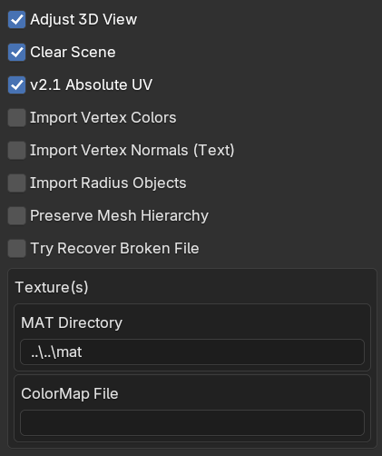

### Import Options

| Option | Default | When enabled |
| --- | --- | --- |
| **Adjust 3D View** | On | Fit the imported model into the viewport. |
| **Clear Scene** | On | Remove content from all scenes before importing the model. |
| **v2.1 Absolute UV** | On | Convert pixel-sized UVs for JKDF2, MOTS, DroidWorks and Grim Fandango. |
| **Import Vertex Colors** | Off | Keep the model's vertex lighting in an editable color layer. |
| **Import Vertex Normals (Text)** | Off | Preserve authored vertex normals when importing legacy text models. |
| **Import Radius Objects** | Off | Show editable wireframe spheres for model and mesh bounds. |
| **Preserve Mesh Hierarchy** | Off | Prefix object names with their original joint numbers. |
| **Try Recover Broken File** | Off | Try importing usable geometry and joints from damaged text models, with recovery warnings. |

Parent links are preserved with or without name prefixes. Binary and identified
Grim models preserve their authored normals automatically.

**Texture(s)**:

| Option | What it does |
| --- | --- |
| **MAT Directory** | Search this folder for the model's textures; leave empty to search common locations. |
| **ColorMap File** | Decode indexed textures using this CMP palette. Blank tries defaults; Grim may need a specific costume palette. |

> ⚠️ **Clear Scene** is on by default and clears content from all scenes in the current blend file. Turn it off to keep existing work.

For damaged files, use **View 3DO Import Report** in **Object Properties > 3DO Properties**.
Recovery may leave missing geometry or joints.

## 📤 Exporting 3DO Models

1. Select the model or one of its joints.
2. Choose **File > Export > Sith Game Engine 3D Model (.3do)**.
3. Choose the **Format** and output filename, then click **Export 3DO**.

| **Format** choice | Use |
| --- | --- |
| 2.1 - JKDF2 & MOTS | Text models for JKDF2, MOTS, DroidWorks, or Grim text output. |
| 2.2 - IJIM (RGB) | Infernal Machine with RGB vertex colors. |
| 2.3 - IJIM | Infernal Machine with RGBA vertex colors; default. |
| Grim Fandango | Grim binary model. |

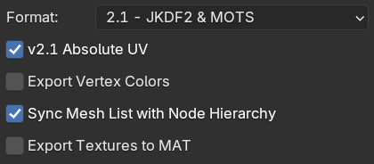

| Option | Default | When enabled |
| --- | --- | --- |
| **v2.1 Absolute UV** | On | Write pixel-sized UVs; shown only for 2.1 and Grim Fandango. |
| **Export Vertex Colors** | Off | Include the active vertex-color layer. |
| **Sync Mesh List with Node Hierarchy** | On | Order exported meshes to follow the joint hierarchy. |
| **Bake Pivots** | Off | Write zero pivots, retaining the surface in exported vertices. Use this to discard obsolete native offsets or recover the earlier zero-pivot workflow. The Blender scene is unchanged. |
| **Detail Levels** | 1 | Write this many geosets, 1 to 4, each a full copy of the model. The game picks a geoset by distance, so copies keep full detail far away. |
| **Fail Over Retail Limits** | Off | Shown for 2.1. Stop the export, writing nothing, when the model is over the JKDF2/MOTS limits. When off, the export only warns. |
| **Export Textures to MAT** | Off | Export the model's image textures; reveals the options below. |

Disable **Sync Mesh List with Node Hierarchy** to keep Blender traversal order instead.

Every 2.1 export is checked against the retail JKDF2/MOTS limits: 512 vertices,
768 texture vertices and 512 faces per mesh, 24 corners per face, 4 geosets and
64 joints. The check counts the exported model: vertices split at sharp edges
and texture vertices at UV seams, so a mesh can go over without being edited. Each problem
is reported as a warning that names the mesh and how far it is over; see the
[budget notes](docs/audits/budget.md).

> ⚠️ Export includes the active model's whole hierarchy, not every selected model. Only LOD 0 is imported; **Detail Levels** writes copies of it, not separate LOD meshes.

### Exporting Model Textures

1. Enable **Export Textures to MAT** in the 3DO export dialog.
2. Leave **MAT Directory** as `mat`, or enter a custom folder.
3. Choose **Encoding**, then click **Export 3DO**.

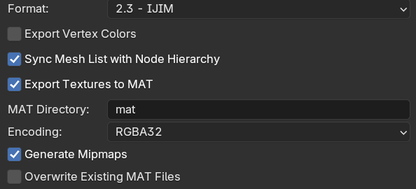

Default output:

```text
export/
  example_cube.3do
  mat/
    checker.mat
```

| Texture option | What it does |
| --- | --- |
| **MAT Directory** | Save MATs in this folder; default `mat` beside the 3DO. Accepts relative, absolute and blend-relative `//` folders. |
| **Encoding** | Encode textures in the selected [format](#encodings). Defaults to RGBA32; selecting 2.1 or Grim initially selects Indexed. |
| **ColorMap File** | Use this CMP palette for Indexed encoding; shown for Indexed only. Relative paths are beside the 3DO. |
| **Generate Mipmaps** | When enabled, create smaller texture levels down to 1x1. On by default; hidden for Grim, which uses the base image only. |
| **Overwrite Existing MAT Files** | When enabled, replace existing MATs in the output folders. Off by default. |
| **8-bit and 16-bit Editions** | When enabled, write every MAT twice with the same name: Indexed with the **ColorMap File** into the 8-bit folder and RGB 565 into the 16-bit folder. Replaces **MAT Directory** and **Encoding**. Off by default; hidden for Grim. |
| **8-bit MAT Directory** | Folder for the Indexed edition; default `mat8` beside the 3DO. Shown with editions. |
| **16-bit MAT Directory** | Folder for the RGB 565 edition; default `mat16` beside the 3DO. It must differ from the 8-bit folder, also when case is ignored and through links. Shown with editions. |
| **Dither Indexed Textures** | When enabled, use an ordered 4x4 pattern of two palette colors where the CMP has no close color, such as skin. A pattern never adds a [fullbright](#fullbright-colors) color. Off by default; shown for Indexed and editions. |
| **Avoid Fullbright Colours** | When enabled, Indexed textures use no [fullbright](#fullbright-colors) color, so they take shadow everywhere. Needs a CMP with its light table, such as the game's `dflt.cmp`. Off by default; shown for Indexed and editions. |

Use **Indexed** for the original JKDF2, MOTS and DroidWorks engines. Grim requires
Indexed and a CMP. A `//` palette path is relative to the blend file.

With editions, the model and both folders are written together or not at all:

```text
export/
  example_cube.3do
  mat8/
    checker.mat    (Indexed, for the software renderer)
  mat16/
    checker.mat    (RGB 565, for 3D acceleration)
```

Dithering keeps colors the palette matches closely as one solid color. To dither
only part of a texture, such as the skin, add an Image custom property named
`sith_dither_mask_0` to the material (`_1`, `_2` for later cels). Texels whose
mask is white (red channel 0.5 or more) may dither; the rest use the nearest color.
The mask must have the same size as the texture. See the
[material notes](docs/audits/materials.md).

#### Fullbright colors

The game draws 8-bit textures through the CMP's light table, which darkens each
palette color in shadow. Some entries are fullbright: the table draws them the
same at every light level, so they glow in shadow. In the stock `dflt.cmp` they
are entries 0 to 31 and 63: pure greens, reds, yellows, oranges, whites, pale
blues and a blue for lights and effects, and black. Dithering never adds a
fullbright color that nearest color would not use; where nearest color picks
one, the texel keeps it. Nearest color still picks one for some saturated
colors, such as a bright red. **Avoid Fullbright Colours** keeps them out of the
Indexed textures entirely, for skin and cloth that must take shadow. It applies
to every texture of the export: export a texture meant to glow, such as eyes,
separately without it. The 16-bit edition is not affected. See the
[fullbright notes](docs/audits/materials.md#fullbright-entries).

Materials export their image textures and bound animation cels, not procedural
shaders or preview lighting. Bake procedural textures to images first.

## 🎬 Importing KEY Animations

1. Import the matching 3DO model first and select it.
2. Choose **File > Import > Sith Game Engine Animation (.key)**.
3. Select the animation and click **Import KEY**.

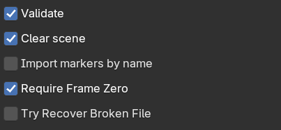

| Option | Default | When enabled |
| --- | --- | --- |
| **Validate** | On | Check that the model has every joint required by the animation before importing. |
| **Clear scene** | On | Remove existing animation in the current scene before importing the KEY. |
| **Import markers by name** | Off | Use readable event names instead of numeric marker IDs. |
| **Require Frame Zero** | On | Reject animation tracks whose first key is not at frame zero. |
| **Try Recover Broken File** | Off | Try importing usable tracks from a damaged KEY, skipping corrupt tracks and reporting omitted data. |

- Disable **Clear scene** to merge, or **Validate** to import matched joints only.
- Disable **Require Frame Zero** to extrapolate late-start tracks back to zero without retiming them.
- Recovery still checks frame zero when required; unsafe headers and truncated binary files cannot be recovered.

Recovery details appear under **View KEY Import Report** in **3DO Properties**.
Text and Grim Fandango binary KEY files are detected automatically.

> 💡 Not sure which animation belongs to a model? Check its `.pup` file or compare joint names.

## 🎬 Exporting KEY Animations

1. Select the animated model or one of its joints.
2. Set the scene's animation range.
3. Choose **File > Export > Sith Game Engine Animation (.key)**.
4. Select **Target**, check **Frame Rate**, and click **Export KEY**.

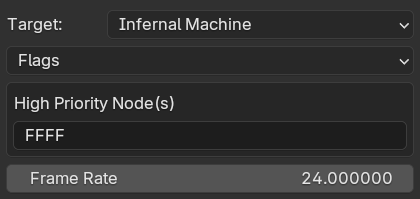

| Option | What it does |
| --- | --- |
| **Target** | Select the output format and game limits; default is Infernal Machine. |
| **Flags** | Preserve KEY header metadata for format completeness; not the original Sith game's playback controls. See the menu choices below. |
| **High Priority Node(s)** | Select which 3DO node types use the animation track's high blending priority. Enter a hex mask; default `FFFF`. |
| **Frame Rate** | Playback FPS, initially taken from the scene; fractional values are supported. |

#### Target Choices

| Target | Use |
| --- | --- |
| Infernal Machine | Text KEY; checks IJIM's joint, marker and name limits. |
| Jedi Knight: Dark Forces II | Text KEY; checks JKDF2 limits. |
| Mysteries of the Sith | Text KEY; checks MOTS limits. |
| Grim Fandango | Binary KEY; checks its marker and physical name-field limits. |
| Generic | Text KEY without game-specific caps; allows nonzero starts. Shared safety checks remain enabled. |

#### Flags Menu

In the original Sith playback path, **PUP files or script calls supply playback
flags**, not the KEY header. These switches are retained for format completeness;
they do not configure Blender playback. The labels describe the corresponding
puppet/playback flags:

| Stored flag | Corresponding playback meaning |
| --- | --- |
| **Movement controlled** | Advance the animation with actor movement rather than its FPS. |
| **No Loop** | Stop after one playback. |
| **Pause On Last Frame** | Hold the final frame. |
| **Restart Active** | Restart an already active animation. |
| **Disable Fade-in** | Start without fading in. |
| **Fade-out & No Loop** | Fade out and finish without looping. |
| **(IJIM) Last Frame Pose** | Apply the animated object's final-frame pose when playback finishes. |

Clearing the checkboxes clears the known flags; imported extra flag bits are kept.
Grim uses different flag meanings; leave imported flags unchanged unless you know
its format ([details](docs/formats/key.md#grim-playback-interpretation)).

#### High Priority Node(s)

- Matches the joint's **3DO Type**, not its **Sequence No.**
- A shared type bit selects the animation track's high priority; no match uses its low priority.
- PUP/playback settings supply those low/high priorities. The mask does not set a numeric priority.
- Example: `0004` matches types `0004` and `0005`, not "joint 4".
- `FFFF` selects all standard type bits; `0000` selects none. Keep imported values when editing existing animation.

> ⚠️ Bake constraints, drivers and NLA motion to ordinary location/rotation animation before exporting. Animated scale is not supported.

For compatibility details, see the [animation notes](docs/blender-compatibility.md#animation-compatibility).

## 🖼️ Importing MAT Textures

1. Choose **File > Import > Sith Game Engine Texture (.mat)**.
2. Select the texture and, for Indexed, enter its CMP path in **ColorMap File**.
3. Click **Import MAT**.

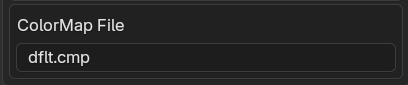

| Option | What it does |
| --- | --- |
| **ColorMap File** | Decode indexed MAT colors using this CMP palette; blank tries defaults. True-color MATs do not need one. |

- 🎞️ All material cels are imported automatically; there is no cel-count option in this dialog.
- 🎨 Wrong colors or a placeholder grid? Select the correct CMP and reload.
- 🔄 Reimporting a MAT updates its existing local images, including other materials that share them.

## Exporting MAT Textures

Use any of these three locations. Images export one cel; materials export all their bound cels.

### Outliner

- Switch the display mode to **Blender File**.
- Right-click an item under **Images** or **Materials** → **Export to MAT...**.

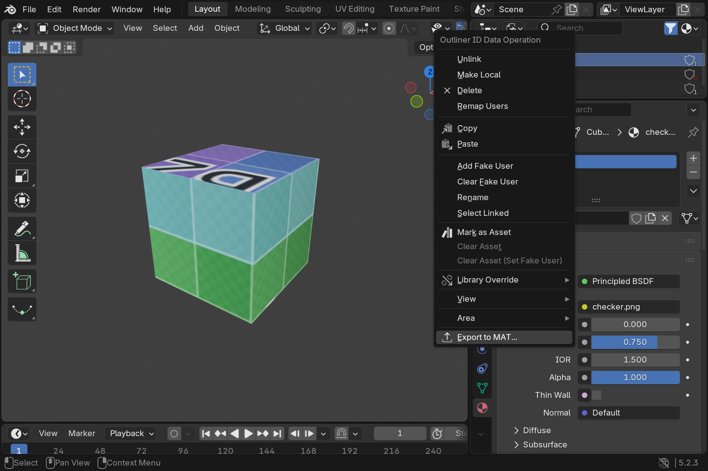

Select the image or material itself, not its containing object.

### Image Editor

- Open the image.
- Choose **Image > Export to MAT...**.

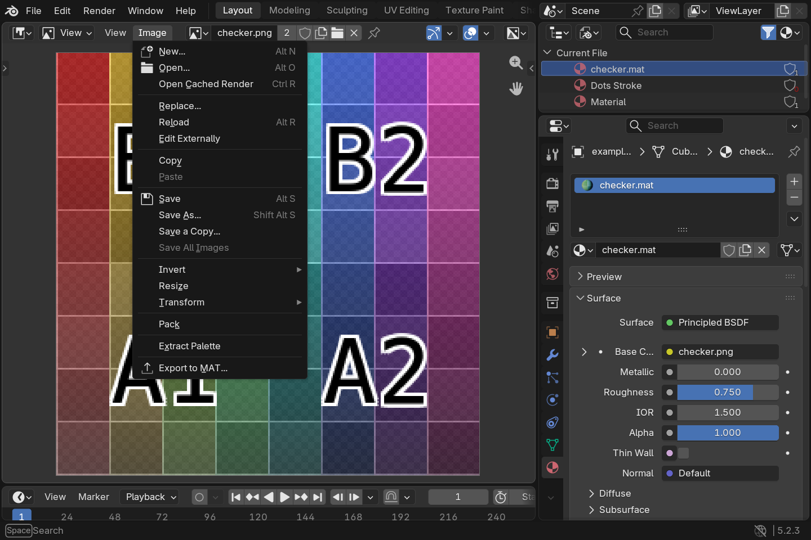

This is a separate command, not a format in Blender's built-in **Save As** dialog.

### Material Properties

- Select the object and open **Material Properties**.
- Right-click the desired material row → **Export to MAT...**.

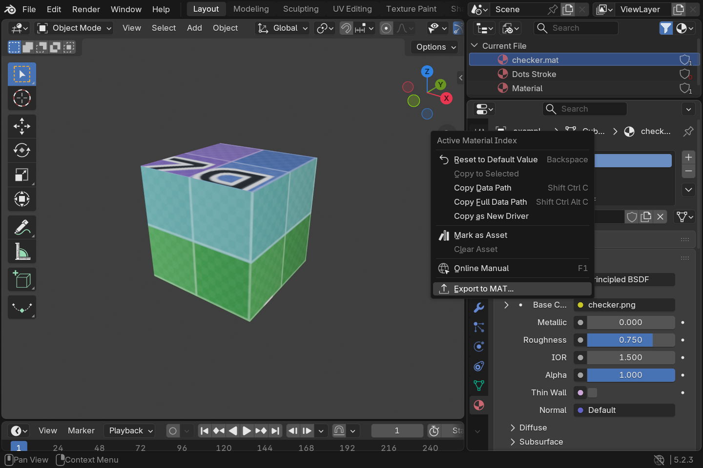

Or use the **Material Specials** dropdown beside the slots to export the active material:

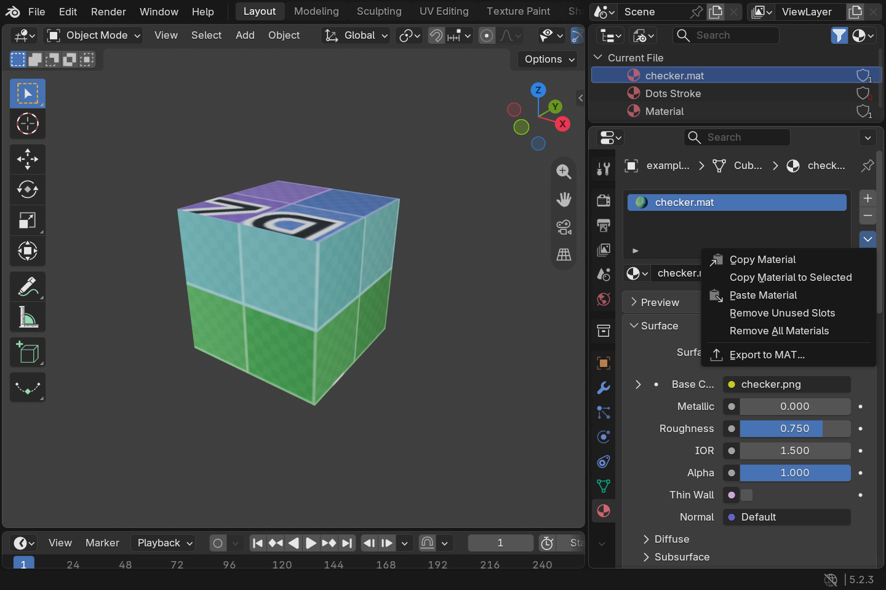

### MAT Export Options

1. Choose the filename and folder.
2. Select **Target** and **Encoding**.
3. For Indexed, enter the CMP path in **ColorMap File**.
4. Click **Export MAT**.

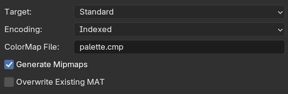

| Option | What it does |
| --- | --- |
| **Target** | **Standard** for ordinary Sith MATs; **Grim Fandango** for Grim-compatible indexed output. Standard is the default. |
| **Encoding** | Choose from the six encodings below. Defaults to RGBA32; fixed to Indexed for Grim. |
| **ColorMap File** | Use this CMP palette for Indexed encoding; shown for Indexed only. Relative paths are beside this MAT; `//` paths are relative to the blend file. |
| **Dither** | When enabled, use an ordered 4x4 pattern of two palette colors where the CMP has no close color. Off by default; shown for Indexed only. A material's `sith_dither_mask_<cel>` image limits it. A pattern never adds a [fullbright](#fullbright-colors) color. |
| **Avoid Fullbright Colours** | When enabled, use no [fullbright](#fullbright-colors) color, so the texture takes shadow everywhere. Needs a CMP with its light table. Off by default; shown for Indexed only. |
| **Generate Mipmaps** | When enabled, create smaller texture levels down to 1x1. On by default; hidden for Grim, which stores only the base image. |
| **Overwrite Existing MAT** | When enabled, allow replacing the existing MAT, with save-dialog confirmation. Off by default. |

#### Encodings

These choices also apply to **Export Textures to MAT** in the 3DO dialog:

| Encoding | Use |
| --- | --- |
| **RGBA32** | 32-bit full color with 8-bit alpha. |
| **RGB 24** | 24-bit full color without transparency. |
| **RGB 565** | 16-bit color without transparency; smaller than RGB 24. |
| **RGBA 4444** | 16-bit color with reduced color and alpha precision. |
| **RGBA 1555** | 16-bit color with on/off transparency. |
| **Indexed** | 8-bit CMP palette colors with on/off transparency; requires a ColorMap File. |

- 📁 Standalone export saves directly to your chosen folder; it does not create a `mat` subfolder.

> 💡 True-color MATs are for compatible engines such as Infernal Machine. Use Indexed for the original JKDF2, MOTS and DroidWorks engines.

## 🎛️ Editing 3DO Properties

### 🎯 Object 3DO Properties

Open **Object Properties > 3DO Properties**.

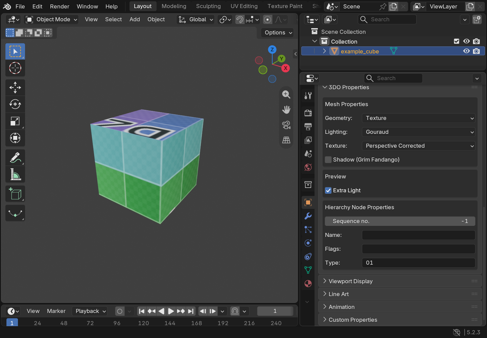

- 📐 **Geometry / Lighting / Texture**: Set how the game draws the mesh.
- 🌑 **Shadow (Grim Fandango)**: Include the mesh in the game's actor shadow; this does not change Blender shadows.
- 🔢 **Sequence No.**: Joint order; `-1` means automatic.
- 🏷️ **Name**: Exported joint name.
- 🚩 **Flags / Type**: Game-specific joint settings.
- 📍 **Native Pivot**: Set the local X/Y/Z native mesh-frame offset on Mesh or Empty joints. Import uses the same property. Editing it preserves the editable surface and KEY joint channels; export compensates native vertices. An active Blender Pivot constraint overrides it.

These are engine properties; they do not necessarily change Blender's viewport.

### 🔷 Mesh Face Properties

1. Enter **Edit Mode** and enable **Face Select**.
2. Select one or more faces.
3. Open **Data Properties > 3DO Mesh Face Properties**.

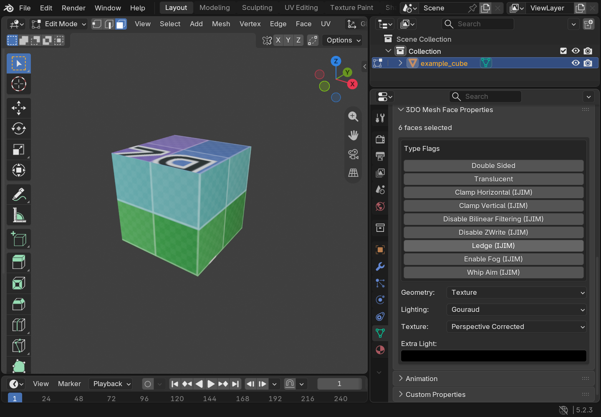

- ↔️ **Double Sided**: Draw both sides.
- 🌫️ **Translucent**: Enable transparency.
- 💡 **Lighting / Extra Light**: Adjust face lighting.
- 🎯 Flags marked **(IJIM)** have Infernal Machine-specific meanings.

Change only the properties you need; other values on the selected faces stay unchanged.

### Extra Light Preview

- 💡 On by default; editing face **Extra Light** updates the preview.
- 🖼️ Use **Material Preview** or **Rendered** shading, not Solid.
- 🎛️ Toggle it under **Object Properties > 3DO Properties > Preview > Extra Light**.
- 🎨 Preview does not bake into vertex colors or texture pixels.

Native pivots are stored as `3do_pivot`. Saved scenes containing the earlier
`3do_imported_pivot` key remain readable without migration; editing **Native Pivot**
writes the shared property, including an explicit zero. Scenes with neither key
keep their previous zero-pivot export behavior. Reimport the native file to recover
an original offset that was never stored. **Bake Pivots** deliberately ignores
stored offsets, including malformed values, and exports the current editable mesh.
Supported Blender Pivot constraints retain their validation and are baked in the
exported copy. Automatic mesh bounds use the emitted coordinates; authored radius
helpers and the model-radius policy remain in effect.

The numeric control defines the exported frame; it does not move the viewport
origin, add a pivot gizmo, or preview attached objects in that native frame.
Full viewport pivot/attachment evaluation is follow-up work. Review origin/Apply
Transform edits separately and test attachments in the target game; these
file/Blender guarantees are not a game-runtime test.

## 🔍 Auditing Models

Open the 3D View sidebar (**N**) and its **Sith** tab. The **Sith Audits** panel
runs the [native audits](docs/audits/README.md) on the active model or on files. Each
report goes to a Text datablock; open it in the **Text Editor**. The commands
do not change model data. **Reseat KEYs** writes new KEYs to the folder you
choose; the others write no files. A finding is a lead to look at in Blender or
in the game, not a verdict.

### Check Retail Limits

1. Select the model or one of its joints.
2. Click **Check Retail Limits**, check the options and click **OK**.

The check builds the model in memory the way the 3DO exporter does, with the
same options, and counts it against the retail JKDF2/MOTS limits: 512 vertices,
768 texture vertices and 512 faces per mesh, 24 corners per face, 4 geosets and
64 joints. Over-limit meshes are listed as warnings. The report is the Text
`<model> - Retail Limits`; see the [budget notes](docs/audits/budget.md).

| Option | Default | What it does |
| --- | --- | --- |
| **Target** | JKDF2 | JKDF2 or MOTS. Both games load models with the same limits. |
| **v2.1 Absolute UV** | On | As in the export dialog: count the pixel-space UVs a 2.1 export writes. |
| **Export Vertex Colors** | Off | As in the export dialog: corners with different colors stay separate vertices. |
| **Sync Mesh List with Node Hierarchy** | On | As in the export dialog: number meshes in node order, so mesh numbers match the export. |
| **Bake Pivots** | Off | As in the export dialog: count the model with zero pivots. |
| **Detail Levels** | 1 | As in the export dialog: count this many geosets, each a copy of the model. |

### Colour Pieces and Restore Colours

**Colour Pieces** paints each piece of the active model one solid color, so you
can see which piece a lump of surface belongs to. It sets the objects' viewport
colors and switches the 3D View's Solid shading color to **Object**. The colors
show in Solid shading. A node keeps its color across models and runs.

| Option | Default | What it does |
| --- | --- | --- |
| **Colour By** | Node | **Node** gives each hierarchy node a color. **Rigid Part** gives one color to the nodes that move with each of Kyle's joints, or to each node when the model has no Kyle names. Change it in **Adjust Last Operation**. |

**Restore Colours** puts back the object colors and the 3D View color mode that
**Colour Pieces** changed. The previous values are kept in the blend file (custom
properties `_sith_saved_color` on objects and `_sith_saved_color_type` on the
scene), so restoring also works after saving and reopening. A color mode you
changed yourself in between is left as you set it.

### Audit Files

1. Click **Audit Files** and select a 3DO file.
2. Set the KEY folder, the checks and the reference pose in the file browser's side panel.
3. Click **Audit Files**.

Blender waits until the audit ends. A full joint-gap sweep can take minutes:
about 80 seconds for 91 KEYs on a 14,600-face model, after the model is read.
Choose **KEY Files** or a larger **Step** for a quicker run. Each check writes the
Text `<3DO file> - <check>`: a summary, then the complete report.

| Option | Default | What it does |
| --- | --- | --- |
| **KEY Folder** | Blank | The KEYs to audit. Blank uses the `key` folder beside the 3DO. |
| **KEY Files** | Blank | Comma-separated file names in the KEY folder, for a shorter run. Blank audits every `.key` file. Names match without case, as in the game; two files whose names differ only in case are refused. |
| **Step** | 2 | Sample each KEY every **Step** frames from frame 0. |
| **Joint Gaps** | On | Find lines of sight through each joint in every sampled pose ([joint gaps](docs/audits/articulation.md)). The slowest check. |
| **Seat Offsets** | On | Measure how far each KEY moves each node from its seat in the reference pose. |
| **Floor Contact** | On | Find samples where the model goes under the engine floor or its lowest point floats above it ([floor contact](docs/audits/ground.md)). |
| **KEY Lint** | On | Check each KEY's header, track table and the motion between its entries ([KEY lint](docs/audits/keylint.md)). |
| **Reference Pose** | Rest Pose | The pose the pieces were cut in: **Rest Pose** or **Reference KEY**. Joint gaps and seat offsets measure from it. |
| **Reference KEY File** | `kystand1.key` | Shown for **Reference KEY**: a file name in the KEY folder, or a path. |
| **Reference Frame** | 0 | Shown for **Reference KEY**: the frame of that KEY. |
| **Zero Rotations** | On | Shown for **Reference KEY**: the nodes it drives take zero rotation. |
| **Move Size** | 0.065 | Shown for **Floor Contact**: the player template's movesize, which sets the engine floor. Stock `walkplayer` uses 0.065. |
| **Crouch KEYs** | `kycrchgn.key, kycrchbk.key` | Shown for **Floor Contact**: KEYs that play on the crouch floor. Names not in the run are ignored. |
| **Lint Target** | JKDF2 | Shown for **KEY Lint**: the game whose KEY limits apply. |

> ⚠️ The reference pose decides the joint-gap counts, and a wrong one gives no
> warning. A character cut with straight joints at a stand KEY's seats needs
> **Reference KEY** with the stand KEY it was cut against and **Zero Rotations**,
> for example the stock `kystand1.key`.

The floor is where physics holds a standing player, not the model's lowest
point. Jumps, falls, deaths and swims float or sink by design. Floor Contact does
not measure foot slip; the Python and MCP audits can.

### Reseat KEYs

1. Click **Reseat KEYs** and select the character's 3DO file.
2. Set the KEY folder, the seats and the **Output Folder** in the file browser's side panel.
3. Click **Reseat KEYs**.

Stock KEYs push some joints a few thousandths of a JK unit off their seats, and a
character cut into close-fitting pieces opens there. **Reseat KEYs** puts those
joints back in the KEY data ([KEY reseat](docs/audits/reseat.md)). The hip piece
moves back between the torso and the thighs; the shoulders, forearms, hands, neck
and head go back to their seats. No rotation changes, and the torso and the legs
stay where the KEY put them.

It is the one command in the panel that writes files. It writes a reseated copy
only of each KEY that changes, only into the **Output Folder**. It never writes
into the KEY folder, never replaces a file and does not change the 3DO. The
report is the Text `<3DO file> - KEY Reseat`: the KEYs written, the check, then
the complete report.

| Option | Default | What it does |
| --- | --- | --- |
| **KEY Folder** | Blank | The KEYs to reseat. Blank uses the `key` folder beside the 3DO. Nothing is written into it. |
| **KEY Files** | Blank | Comma-separated file names in the KEY folder. Blank reseats every `.key` file. Names match without case, as in the game; two files whose names differ only in case are refused. |
| **Seats** | Stand KEY | Where each joint's seat comes from: **Stand KEY**, or **Model Rest Positions** only when the rest pose matches the stand KEY. |
| **Stand KEY File** | `kystand1.key` | Shown for **Stand KEY**: a file name in the KEY folder, or a path. |
| **Stand Frame** | 0 | Shown for **Stand KEY**: the frame of that KEY. |
| **Waist Tuck** | 0.0025 | The most of the thighs' leftover push into the hip that goes to the waist as a small overlap, in JK units. |
| **Waist Lift** | 0 | How far the hip may follow the torso up where a waist gap is left. The hip joints open by as much. Lilivane R3 used 0.0015. |
| **Check** | On | Load each written KEY back and pose it against its source: no rotation may change, and no joint but the hip and the seated joints may move. A failed check is an error; do not install that KEY. |
| **Output Folder** | Blank | Required. The folder for the reseated KEYs. It must not be the KEY folder or hold a file named like one of the KEYs. |

> ⚠️ A GOB's KEYs replace the stock ones for every player model in that
> install. Reseated stock KEYs change the joints of the other characters too.

Install only the written KEYs, after review. Its limits:

- The check shows that nothing else moved, not that the joints close. Run
  **Audit Files** with **Joint Gaps** before and after, on the same KEYs, **Step**
  and reference pose: on the KEY folder with **KEY Files** set to the written
  KEYs, then on the Output Folder. Give the **Reference KEY File** as a path, so
  that both runs use the same file.
- It needs Kyle's hip layout, with one node each named `k_hip`, `k_torso`,
  `k_lthigh`, `k_rthigh`, `k_lshouldr`, `k_lforearm`, `k_lhand`, `k_rshouldr`,
  `k_rforearm`, `k_rhand`, `k_neck` and `k_head`. Run it before adding custom
  tracks that move the hip's frames, such as ground-contact tracks: with them the
  hip rule is reported as unsupported and the hip is left alone.
- It rewrites Kyle's own tracks, never adapter tracks. A rig whose stock tracks
  must stay byte for byte, such as Biddy Blas's, needs another fix.
- It cannot close a waist that opens from rotation alone, with every joint on
  its seat.
- Each KEY is checked alone at full weight. Blends, fades, the player's aim
  pitch and puppet timing are not checked.
- Text KEYs only.

## 🔧 Troubleshooting

| Problem | Try |
| --- | --- |
| Missing textures | Set **MAT Directory** and reload the model. |
| Wrong indexed colors | Choose the correct **ColorMap File**; do not guess from the model name. |
| Face controls do nothing | Use Edit Mode, Face Select and at least one selected face. |
| Extra Light is invisible | Switch to Material Preview or Rendered shading. |
| Export asks for baking | Apply mesh modifiers; bake unsupported constraints, drivers or NLA motion. |
| A damaged file will not load | Try recovery, then inspect its report; not every file can be recovered. |

For detailed restrictions, see [compatibility notes](docs/blender-compatibility.md).
For file formats and conversion diagrams, see [technical documentation](docs/README.md).

[← Back to README](README.md)
